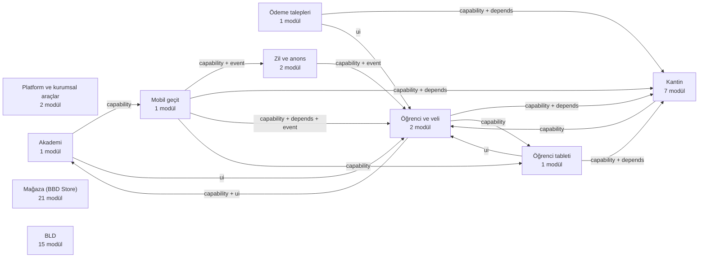

# Modül grafiği (ÜRETİLMİŞ — elle düzenlemeyin)

Üretici: `python3 tools/module-graph.py --write` · Tarayıcı: `tools/arch_scan.py` · Karar: [ADR 0033](../adr/0033-alan-servisleri-ve-sinirlar.md) · Yorum: [envanter-2026-10-16.md](envanter-2026-10-16.md)

**53 modül** (28 açık, 25 kapalı) · 292.608 satır (py/js/sql/css, testler hariç) · 10 alan

## 1. Alan haritası

| Alan | Ad | Modül | Açık | Satır | Sınıf üst sınırı |
|---|---|---:|---:|---:|---|
| `platform` | Platform ve kurumsal araçlar | 2 | 2 | 3.051 | personal |
| `academy` | Akademi | 1 | 1 | 64.552 | financial |
| `students` | Öğrenci ve veli | 2 | 2 | 17.693 | personal |
| `canteen` | Kantin | 7 | 7 | 15.972 | financial |
| `payments` | Ödeme talepleri | 1 | 1 | 3.523 | financial |
| `tablet` | Öğrenci tableti | 1 | 1 | 12.224 | personal |
| `bell` | Zil ve anons | 2 | 2 | 8.405 | personal |
| `gateway` | Mobil geçit | 1 | 1 | 5.214 | financial |
| `store` | Mağaza (BBD Store) | 21 | 11 | 103.238 | financial |
| `bld` | BLD | 15 | 0 | 58.736 | financial |

## 2. Modüller

| Modül | Alan | Sınıf | Durum | Satır | depends | sağlar | tüketir (modül yeteneği) | yayımlar | dinler |
|---|---|---|---|---:|---|---|---|---|---|
| `antivirus` | platform | internal | açık | 1.974 | — | `antivirus.scan` | — | `antivirus.scan_started`, `antivirus.scan_completed`, `antivirus.threat_found`, `antivirus.signatures_stale` | — |
| `print` | platform | personal | açık | 1.077 | — | — | — | — | — |
| `bbd_akademi` | academy | financial | açık | 64.552 | — | `akademi.student_finance`, `bbd_akademi.students` | `mobile_gateway.events` | — | — |
| `bbd_sms` | students | personal | açık | 2.621 | `bbd_canteen_api` | — | `canteen.api` | — | — |
| `bbd_students` | students | personal | açık | 15.072 | — | `bbd_students.list`, `bbd_students.manager`, `bbd_students.record`, `bbd_students.search`, `bbd_students.open`, `bbd_students.directory`, `bbd_students.groups`, `bbd_students.sync` | `canteen.api`, `bbd_tablet.control`, `akademi.student_finance` | `bbd_students.groups_changed`, `bbd_students.group_deleted` | — |
| `bbd_bulk_sale` | canteen | financial | açık | 2.812 | `bbd_canteen_api` | — | `canteen.api` | — | — |
| `bbd_canteen_api` | canteen | financial | açık | 2.033 | — | `canteen.api` | `bbd_students.sync` | `canteen.device_enrolled` | — |
| `bbd_canteen_backups` | canteen | financial | açık | 1.057 | `bbd_canteen_api` | — | `canteen.api` | — | — |
| `bbd_canteen_devices` | canteen | internal | açık | 1.686 | `bbd_canteen_api` | — | `canteen.api` | `canteen.device_enrolled`, `canteen.kiosk_revoked` | — |
| `bbd_canteen_products` | canteen | internal | açık | 1.899 | `bbd_canteen_api` | — | `canteen.api` | — | — |
| `bbd_canteen_reports` | canteen | financial | açık | 3.786 | `bbd_canteen_api` | — | `canteen.api` | — | — |
| `bbd_lunch` | canteen | financial | açık | 2.699 | `bbd_canteen_api` | — | `canteen.api` | — | — |
| `bbd_payment_request` | payments | financial | açık | 3.523 | `bbd_canteen_api` | `bbd_payment_request.student_card` | `canteen.api` | — | — |
| `bbd_tablet` | tablet | personal | açık | 12.224 | `bbd_canteen_api` | `bbd_tablet.read`, `bbd_tablet.control`, `bbd_tablet.student_quick` | `canteen.api` | — | — |
| `bbd_class_schedule` | bell | internal | açık | 531 | `bell` | — | `bell.week` | — | — |
| `bell` | bell | personal | açık | 7.874 | — | `bell.week`, `bell.plan`, `bell.announce` | `bbd_students.groups`, `bbd_students.directory` | `bell.rang`, `bell.failed`, `bell.week_changed` | `bbd_students.groups_changed`, `bbd_students.group_deleted` |
| `mobile_gateway` | gateway | financial | açık | 5.214 | `bbd_canteen_api`, `bbd_students` | `mobile_gateway.events` | `canteen.api`, `bbd_students.directory`, `bbd_tablet.read`, `bbd_tablet.control`, `bell.week`, `bell.announce`, `bell.plan`, `bbd_students.groups` | — | `bell.week_changed`, `bbd_students.groups_changed` |
| `store_ai` | store | internal | **kapalı** | 3.910 | `store_api` | — | `store.api` | `store_ai.suggestions_applied` | — |
| `store_api` | store | financial | açık | 5.208 | — | `store.api`, `store.scan` | — | — | — |
| `store_backups` | store | financial | **kapalı** | 2.216 | `store_api` | — | `store.api` | `store.backup.created`, `store.backup.restored` | — |
| `store_bundles` | store | internal | açık | 3.146 | `store_api` | — | `store.api` | — | — |
| `store_cms` | store | public | **kapalı** | 4.555 | `store_api` | — | `store.api` | — | — |
| `store_customers` | store | personal | açık | 5.292 | `store_api` | `store.customer.card` | `store.api`, `store.scan` | `store.customer.anonymized`, `store.review.moderated` | — |
| `store_dashboard` | store | financial | açık | 4.663 | `store_api` | — | `store.api`, `store.scan` | — | — |
| `store_home_media` | store | public | **kapalı** | 2.437 | `store_api` | — | `store.api` | `store_home_media.layout_changed` | — |
| `store_invoices` | store | financial | açık | 3.525 | `store_api` | `store.invoice.byOrder` | `store.api` | `store.invoice.issued` | — |
| `store_notifications` | store | personal | açık | 5.619 | `store_api` | `store.notify.send`, `store.notify.stage` | `store.api` | `store.notification.sent` | — |
| `store_orders` | store | financial | açık | 6.993 | `store_api` | `store.order.card` | `store.api`, `store.scan`, `store.shipment.byOrder`, `store.invoice.byOrder`, `store.audit.for`, `store.notify.stage` | `store.order.status_changed` | — |
| `store_payment_gateway` | store | financial | **kapalı** | 4.946 | `store_api` | — | `store.api` | — | — |
| `store_products` | store | internal | açık | 11.688 | `store_api` | `store_products.deleted_marker` | `store.api` | — | — |
| `store_promotions` | store | internal | **kapalı** | 5.134 | `store_api` | — | `store.api` | `store.promotion.changed` | — |
| `store_refunds` | store | financial | açık | 4.204 | `store_api` | — | `store.api` | — | — |
| `store_reports` | store | financial | **kapalı** | 4.822 | `store_api` | — | `store.api` | — | — |
| `store_requests` | store | personal | **kapalı** | 4.234 | `store_api` | — | `store.api`, `store.order.card`, `store.customer.card`, `store.audit.for` | `store_requests.approved` | — |
| `store_shipping` | store | personal | açık | 9.584 | `store_api` | `store.shipment.byOrder` | `store.api`, `store.notify.send`, `store.notify.stage` | `store.shipment.created`, `store.shipment.purchased`, `store.shipment.cancelled` | — |
| `store_tax` | store | internal | **kapalı** | 4.252 | `store_api` | `store.tax.rates` | `store.api` | — | — |
| `store_trial_club` | store | personal | **kapalı** | 4.164 | `store_api` | — | `store.api`, `store.notify.send` | `store.trial.results_published` | — |
| `store_udit_logs` | store | personal | açık | 2.646 | `store_api` | `store.audit.for` | `store.api` | — | — |
| `bld_api` | bld | financial | **kapalı** | 4.973 | — | `bld.api` | — | — | — |
| `bld_cms` | bld | public | **kapalı** | 4.160 | `bld_api` | — | `bld.api` | — | — |
| `bld_customers` | bld | personal | **kapalı** | 3.745 | `bld_api` | — | `bld.api` | `bld_customers.account_disabled` | — |
| `bld_dashboard` | bld | financial | **kapalı** | 1.890 | `bld_api` | — | `bld.api` | — | — |
| `bld_invoices` | bld | financial | **kapalı** | 2.500 | `bld_api` | — | `bld.api` | — | — |
| `bld_kds` | bld | personal | **kapalı** | 5.835 | `bld_api` | — | `bld.api` | `bld_kds.device_revoked`, `bld_kds.order_status_changed` | — |
| `bld_manual_order` | bld | financial | **kapalı** | 3.089 | `bld_api` | — | `bld.api` | — | — |
| `bld_menu` | bld | internal | **kapalı** | 5.344 | `bld_api` | — | `bld.api` | `bld_menu.day_published`, `bld_menu.day_unpublished`, `bld_menu.stock_changed` | — |
| `bld_notifications` | bld | personal | **kapalı** | 2.897 | `bld_api` | — | `bld.api` | — | — |
| `bld_orders` | bld | financial | **kapalı** | 3.337 | `bld_api` | — | `bld.api` | `bld_orders.order_status_changed`, `bld_orders.order_cancelled` | — |
| `bld_products` | bld | internal | **kapalı** | 3.374 | `bld_api` | — | `bld.api` | `bld_products.product_retired` | — |
| `bld_sales_settings` | bld | internal | **kapalı** | 3.779 | `bld_api` | — | `bld.api` | `bld_sales_settings.ordering_paused`, `bld_sales_settings.ordering_resumed` | — |
| `bld_sms` | bld | personal | **kapalı** | 3.889 | `bld_api` | — | `bld.api` | `bld_sms.announcement_sent` | — |
| `bld_status_monitor` | bld | internal | **kapalı** | 3.665 | `bld_api` | — | `bld.api` | `bld_status_monitor.health_changed`, `bld_status_monitor.command_sent` | — |
| `bld_subscriptions` | bld | financial | **kapalı** | 6.259 | `bld_api` | — | `bld.api` | `bld_subscriptions.subscription_status_changed`, `bld_subscriptions.payment_marked_paid` | — |

## 3. Alanlar arası kenarlar

Kaynak hedefe bağımlıdır. Alan içi kenarlar grafikte, burada yalnız alan DIŞI olanlar.

| Kaynak (alan) | Hedef (alan) | Tür | Ne |
|---|---|---|---|
| `bbd_akademi` (academy) | `bbd_students` (students) | ui | `bbd_students.manager` |
| `bbd_akademi` (academy) | `bbd_students` (students) | ui | `bbd_students.record` |
| `bbd_akademi` (academy) | `mobile_gateway` (gateway) | capability | `mobile_gateway.events (ops.)` |
| `bbd_canteen_api` (canteen) | `bbd_students` (students) | capability | `bbd_students.sync (ops.)` |
| `bbd_payment_request` (payments) | `bbd_canteen_api` (canteen) | capability | `canteen.api` |
| `bbd_payment_request` (payments) | `bbd_canteen_api` (canteen) | depends |  |
| `bbd_payment_request` (payments) | `bbd_students` (students) | ui | `bbd_students.open` |
| `bbd_sms` (students) | `bbd_canteen_api` (canteen) | capability | `canteen.api` |
| `bbd_sms` (students) | `bbd_canteen_api` (canteen) | depends |  |
| `bbd_students` (students) | `bbd_akademi` (academy) | capability | `akademi.student_finance (ops.)` |
| `bbd_students` (students) | `bbd_akademi` (academy) | ui | `bbd_akademi.students` |
| `bbd_students` (students) | `bbd_canteen_api` (canteen) | capability | `canteen.api` |
| `bbd_students` (students) | `bbd_tablet` (tablet) | capability | `bbd_tablet.control (ops.)` |
| `bbd_tablet` (tablet) | `bbd_canteen_api` (canteen) | capability | `canteen.api` |
| `bbd_tablet` (tablet) | `bbd_canteen_api` (canteen) | depends |  |
| `bbd_tablet` (tablet) | `bbd_students` (students) | ui | `bbd_students.open` |
| `bell` (bell) | `bbd_students` (students) | capability | `bbd_students.directory (ops.)` |
| `bell` (bell) | `bbd_students` (students) | capability | `bbd_students.groups (ops.)` |
| `bell` (bell) | `bbd_students` (students) | event | `bbd_students.group_deleted` |
| `bell` (bell) | `bbd_students` (students) | event | `bbd_students.groups_changed` |
| `mobile_gateway` (gateway) | `bbd_canteen_api` (canteen) | capability | `canteen.api` |
| `mobile_gateway` (gateway) | `bbd_canteen_api` (canteen) | depends |  |
| `mobile_gateway` (gateway) | `bbd_students` (students) | capability | `bbd_students.directory` |
| `mobile_gateway` (gateway) | `bbd_students` (students) | capability | `bbd_students.groups (ops.)` |
| `mobile_gateway` (gateway) | `bbd_students` (students) | depends |  |
| `mobile_gateway` (gateway) | `bbd_students` (students) | event | `bbd_students.groups_changed` |
| `mobile_gateway` (gateway) | `bbd_tablet` (tablet) | capability | `bbd_tablet.control (ops.)` |
| `mobile_gateway` (gateway) | `bbd_tablet` (tablet) | capability | `bbd_tablet.read (ops.)` |
| `mobile_gateway` (gateway) | `bell` (bell) | capability | `bell.announce (ops.)` |
| `mobile_gateway` (gateway) | `bell` (bell) | capability | `bell.plan (ops.)` |
| `mobile_gateway` (gateway) | `bell` (bell) | capability | `bell.week (ops.)` |
| `mobile_gateway` (gateway) | `bell` (bell) | event | `bell.week_changed` |

## 4. Alan grafiği



## 5. Modül grafiği (açık modüller)

```mermaid
flowchart LR
  subgraph platform["Platform ve kurumsal araçlar"]
    antivirus
    print
  end
  subgraph academy["Akademi"]
    bbd_akademi
  end
  subgraph students["Öğrenci ve veli"]
    bbd_sms
    bbd_students
  end
  subgraph canteen["Kantin"]
    bbd_bulk_sale
    bbd_canteen_api
    bbd_canteen_backups
    bbd_canteen_devices
    bbd_canteen_products
    bbd_canteen_reports
    bbd_lunch
  end
  subgraph payments["Ödeme talepleri"]
    bbd_payment_request
  end
  subgraph tablet["Öğrenci tableti"]
    bbd_tablet
  end
  subgraph bell["Zil ve anons"]
    bbd_class_schedule
    bell
  end
  subgraph gateway["Mobil geçit"]
    mobile_gateway
  end
  subgraph store["Mağaza (BBD Store)"]
    store_api
    store_bundles
    store_customers
    store_dashboard
    store_invoices
    store_notifications
    store_orders
    store_products
    store_refunds
    store_shipping
    store_udit_logs
  end
  bbd_akademi --> bbd_students
  bbd_akademi --> mobile_gateway
  bbd_bulk_sale --> bbd_canteen_api
  bbd_canteen_api --> bbd_students
  bbd_canteen_backups --> bbd_canteen_api
  bbd_canteen_devices --> bbd_canteen_api
  bbd_canteen_products --> bbd_canteen_api
  bbd_canteen_reports --> bbd_canteen_api
  bbd_class_schedule --> bell
  bbd_lunch --> bbd_canteen_api
  bbd_payment_request --> bbd_canteen_api
  bbd_payment_request --> bbd_students
  bbd_sms --> bbd_canteen_api
  bbd_students --> bbd_akademi
  bbd_students --> bbd_canteen_api
  bbd_students --> bbd_tablet
  bbd_tablet --> bbd_canteen_api
  bbd_tablet --> bbd_students
  bell --> bbd_students
  mobile_gateway --> bbd_canteen_api
  mobile_gateway --> bbd_students
  mobile_gateway --> bbd_tablet
  mobile_gateway --> bell
  store_bundles --> store_api
  store_customers --> store_api
  store_dashboard --> store_api
  store_dashboard --> store_udit_logs
  store_invoices --> store_api
  store_notifications --> store_api
  store_orders --> store_api
  store_orders --> store_invoices
  store_orders --> store_notifications
  store_orders --> store_shipping
  store_orders --> store_udit_logs
  store_products --> store_api
  store_refunds --> store_api
  store_shipping --> store_api
  store_shipping --> store_notifications
  store_udit_logs --> store_api
```

## 6. Sınır bulguları

32 bulgu · istisnada 32 · yeni 0 (kapı: `python3 tools/check-boundaries.py`).

| Kural | Modül | Hedef | Yer |
|---|---|---|---|
| core-knows-module | `km_core` | `bbd_bulk_sale` | `backend/src/km_core/security/migrations.py:333` |
| core-knows-module | `km_core` | `bbd_bulk_sale` | `backend/src/km_core/security/migrations.py:334` |
| core-knows-module | `km_core` | `bbd_canteen_backups` | `backend/src/km_core/security/migrations.py:335` |
| core-knows-module | `km_core` | `bbd_canteen_products` | `backend/src/km_core/security/migrations.py:336` |
| core-knows-module | `km_core` | `bbd_canteen_products` | `backend/src/km_core/security/migrations.py:337` |
| core-knows-module | `km_core` | `bbd_canteen_reports` | `backend/src/km_core/security/migrations.py:338` |
| core-knows-module | `km_core` | `bbd_class_schedule` | `backend/src/km_core/security/migrations.py:339` |
| core-knows-module | `km_core` | `bbd_lunch` | `backend/src/km_core/security/migrations.py:340` |
| core-knows-module | `km_core` | `bbd_lunch` | `backend/src/km_core/security/migrations.py:341` |
| core-knows-module | `km_core` | `bbd_payment_request` | `backend/src/km_core/security/migrations.py:342` |
| core-knows-module | `km_core` | `bbd_sms` | `backend/src/km_core/security/migrations.py:343` |
| core-knows-module | `km_core` | `bbd_students` | `backend/src/km_core/security/migrations.py:344` |
| core-knows-module | `km_core` | `bbd_students` | `backend/src/km_core/security/migrations.py:345` |
| core-knows-module | `km_core` | `bbd_students` | `backend/src/km_core/security/migrations.py:346` |
| core-knows-module | `km_core` | `bbd_tablet` | `backend/src/km_core/http/app.py:522` |
| core-knows-module | `km_core` | `print` | `backend/src/km_core/http/documents.py:92` |
| core-knows-module | `km_platform` | `bell` | `backend/src/km_platform/events/outbox.py:61` |
| core-table | `print` | `outputs` | `modules/print/backend/service.py:105` |
| core-table | `print` | `outputs` | `modules/print/backend/service.py:113` |
| core-table | `print` | `outputs` | `modules/print/backend/service.py:140` |
| core-table | `print` | `outputs` | `modules/print/backend/service.py:143` |
| core-table | `print` | `outputs` | `modules/print/backend/service.py:146` |
| core-table | `print` | `outputs` | `modules/print/backend/service.py:192` |
| core-table | `print` | `outputs` | `modules/print/backend/service.py:322` |
| core-table | `print` | `outputs` | `modules/print/backend/service.py:400` |
| core-table | `print` | `outputs` | `modules/print/backend/service.py:404` |
| core-table | `print` | `users` | `modules/print/backend/service.py:113` |
| core-table | `print` | `users` | `modules/print/backend/service.py:146` |
| foreign-api | `bbd_akademi` | `bbd_students` | `modules/bbd_akademi/ui/panel/students-groups.js:34` |
| foreign-api | `bbd_akademi` | `bbd_students` | `modules/bbd_akademi/ui/panel/timetable-copy.js:149` |
| foreign-api | `bbd_akademi` | `bell` | `modules/bbd_akademi/ui/panel/institution-calendar.js:153` |
| foreign-api | `bbd_akademi` | `bell` | `modules/bbd_akademi/ui/panel/timetable-bell-status.js:66` |

## 7. Modüller arası birebir aynı dosyalar

- **kit.js** (4 kopya): `modules/bbd_bulk_sale/ui/panel/kit.js`, `modules/bbd_canteen_backups/ui/panel/kit.js`, `modules/bbd_canteen_products/ui/panel/kit.js`, `modules/bbd_lunch/ui/panel/kit.js`
- **picker.js** (4 kopya): `modules/bbd_bulk_sale/ui/panel/picker.js`, `modules/bbd_lunch/ui/panel/picker.js`, `modules/bbd_payment_request/ui/panel/picker.js`, `modules/bbd_sms/ui/panel/picker.js`
- **kit.js** (3 kopya): `modules/bbd_canteen_reports/ui/panel/kit.js`, `modules/bbd_payment_request/ui/panel/kit.js`, `modules/bbd_sms/ui/panel/kit.js`
- **datefield.js** (2 kopya): `modules/bbd_bulk_sale/ui/panel/datefield.js`, `modules/bbd_canteen_reports/ui/panel/datefield.js`

## 8. Modüller arası gövdesi aynı Python fonksiyonları

- `_export_dir` — 21 yer, 21 modül: `bld_invoices`, `bld_orders`, `store_ai`, `store_backups`, `store_bundles`, `store_cms`, `store_customers`, `store_dashboard`, `store_invoices`, `store_notifications`, `store_orders`, `store_payment_gateway`, `store_products`, `store_promotions`, `store_refunds`, `store_reports`, `store_requests`, `store_shipping`, `store_tax`, `store_trial_club`, `store_udit_logs`
- `print_report` — 17 yer, 17 modül: `store_ai`, `store_bundles`, `store_cms`, `store_customers`, `store_dashboard`, `store_invoices`, `store_notifications`, `store_orders`, `store_payment_gateway`, `store_products`, `store_promotions`, `store_refunds`, `store_reports`, `store_requests`, `store_tax`, `store_trial_club`, `store_udit_logs`
- `preview` — 16 yer, 16 modül: `store_ai`, `store_bundles`, `store_cms`, `store_customers`, `store_dashboard`, `store_invoices`, `store_notifications`, `store_orders`, `store_payment_gateway`, `store_products`, `store_promotions`, `store_refunds`, `store_requests`, `store_shipping`, `store_tax`, `store_trial_club`
- `_announce` — 13 yer, 13 modül: `bbd_canteen_devices`, `bld_customers`, `bld_kds`, `bld_menu`, `bld_orders`, `bld_products`, `bld_sales_settings`, `bld_sms`, `bld_status_monitor`, `bld_subscriptions`, `store_invoices`, `store_notifications`, `store_shipping`
- `_record_of` — 10 yer, 10 modül: `bld_cms`, `bld_customers`, `bld_kds`, `bld_manual_order`, `bld_menu`, `bld_notifications`, `bld_orders`, `bld_products`, `bld_status_monitor`, `bld_subscriptions`
- `_items` — 9 yer, 9 modül: `bld_cms`, `bld_customers`, `bld_dashboard`, `bld_kds`, `bld_orders`, `bld_products`, `bld_sms`, `bld_status_monitor`, `bld_subscriptions`
- `_meta` — 7 yer, 7 modül: `bld_cms`, `bld_dashboard`, `bld_invoices`, `bld_orders`, `bld_sms`, `bld_status_monitor`, `bld_subscriptions`
- `_set_pref` — 6 yer, 6 modül: `store_ai`, `store_dashboard`, `store_notifications`, `store_orders`, `store_products`, `store_trial_club`
- `as_int` — 6 yer, 6 modül: `bld_cms`, `store_cms`, `store_payment_gateway`, `store_products`, `store_reports`, `store_udit_logs`
- `_pref` — 5 yer, 5 modül: `store_ai`, `store_dashboard`, `store_products`, `store_shipping`, `store_trial_club`
- `as_int` — 4 yer, 4 modül: `bbd_canteen_devices`, `bld_kds`, `bld_orders`, `bld_status_monitor`
- `parse_iso` — 4 yer, 4 modül: `bbd_canteen_devices`, `bld_kds`, `bld_orders`, `bld_status_monitor`
- `_config_value` — 3 yer, 3 modül: `store_customers`, `store_dashboard`, `store_products`
- `_day_bounds_ms` — 3 yer, 3 modül: `bbd_bulk_sale`, `bbd_canteen_reports`, `bbd_lunch`
- `_rows` — 3 yer, 3 modül: `bld_manual_order`, `bld_menu`, `bld_notifications`
- `as_bool` — 3 yer, 3 modül: `bld_kds`, `bld_orders`, `bld_status_monitor`
- `as_float` — 3 yer, 3 modül: `store_promotions`, `store_reports`, `store_shipping`
- `camel` — 3 yer, 3 modül: `store_customers`, `store_home_media`, `store_promotions`
- `opt_int` — 3 yer, 3 modül: `bld_dashboard`, `bld_menu`, `bld_subscriptions`
- `page_count` — 3 yer, 3 modül: `bbd_akademi`, `bbd_canteen_reports`, `bbd_students`
- `save_prefs` — 3 yer, 3 modül: `bld_orders`, `bld_status_monitor`, `bld_subscriptions`
- `__init__` — 2 yer, 2 modül: `bld_api`, `store_api`
- `__init__` — 2 yer, 2 modül: `bld_cms`, `store_cms`
- `__init__` — 2 yer, 2 modül: `bld_products`, `bld_subscriptions`
- `_age_seconds` — 2 yer, 2 modül: `bld_api`, `store_api`
- `_announce` — 2 yer, 2 modül: `antivirus`, `store_backups`
- `_export_dir` — 2 yer, 2 modül: `bbd_canteen_reports`, `bbd_students`
- `_local_iso` — 2 yer, 2 modül: `bbd_students`, `bell`
- `_meta_of` — 2 yer, 2 modül: `bld_customers`, `bld_products`
- `_parse` — 2 yer, 2 modül: `bbd_canteen_backups`, `bbd_payment_request`
- `_record` — 2 yer, 2 modül: `store_dashboard`, `store_notifications`
- `_record` — 2 yer, 2 modül: `store_orders`, `store_refunds`
- `_report` — 2 yer, 2 modül: `bld_api`, `store_api`
- `_retry_after` — 2 yer, 2 modül: `bld_api`, `store_api`
- `_student_view` — 2 yer, 2 modül: `bbd_bulk_sale`, `bbd_lunch`
- `_warn` — 2 yer, 2 modül: `bld_api`, `store_api`
- `_write` — 2 yer, 2 modül: `bld_api`, `store_api`
- `after` — 2 yer, 2 modül: `bld_api`, `store_api`
- `as_bool` — 2 yer, 2 modül: `bld_customers`, `bld_products`
- `audit` — 2 yer, 2 modül: `store_dashboard`, `store_notifications`
- `audit` — 2 yer, 2 modül: `store_orders`, `store_refunds`
- `before` — 2 yer, 2 modül: `bld_api`, `store_api`
- `camel` — 2 yer, 2 modül: `store_bundles`, `store_tax`
- `choice_error` — 2 yer, 2 modül: `bld_orders`, `bld_status_monitor`
- `clean_direction` — 2 yer, 2 modül: `bld_customers`, `bld_products`
- `clean_sort` — 2 yer, 2 modül: `bld_customers`, `bld_products`
- `clean_status` — 2 yer, 2 modül: `bld_customers`, `bld_products`
- `create_revision` — 2 yer, 2 modül: `bld_kds`, `bld_orders`
- `date_error` — 2 yer, 2 modül: `bld_orders`, `bld_status_monitor`
- `delete_preset` — 2 yer, 2 modül: `bbd_bulk_sale`, `bbd_sms`
- `drop` — 2 yer, 2 modül: `bld_api`, `store_api`
- `extension` — 2 yer, 2 modül: `bld_api`, `store_api`
- `filter_style` — 2 yer, 2 modül: `bld_cms`, `store_cms`
- `get` — 2 yer, 2 modül: `bld_api`, `store_api`
- `handle_endtag` — 2 yer, 2 modül: `bld_cms`, `store_cms`
- `handle_startendtag` — 2 yer, 2 modül: `bld_cms`, `store_cms`
- `handle_starttag` — 2 yer, 2 modül: `bld_cms`, `store_cms`
- `mask_mapping` — 2 yer, 2 modül: `bld_api`, `store_api`
- `mask_text` — 2 yer, 2 modül: `bld_api`, `store_api`
- `max_upload_bytes` — 2 yer, 2 modül: `bld_api`, `store_api`
- `minutes_since` — 2 yer, 2 modül: `bbd_canteen_devices`, `bld_kds`
- `normalize_color` — 2 yer, 2 modül: `bld_cms`, `store_cms`
- `normalize_patch` — 2 yer, 2 modül: `store_cms`, `store_products`
- `pick` — 2 yer, 2 modül: `store_backups`, `store_udit_logs`
- `pick` — 2 yer, 2 modül: `store_customers`, `store_home_media`
- `pick` — 2 yer, 2 modül: `store_notifications`, `store_orders`
- `preview` — 2 yer, 2 modül: `bbd_canteen_reports`, `bbd_students`
- `preview` — 2 yer, 2 modül: `bld_invoices`, `store_udit_logs`
- `put` — 2 yer, 2 modül: `bld_api`, `store_api`
- `reason_error` — 2 yer, 2 modül: `bbd_canteen_devices`, `bld_kds`
- `recent` — 2 yer, 2 modül: `bld_api`, `store_api`
- `result` — 2 yer, 2 modül: `bld_cms`, `store_cms`
- `reverse` — 2 yer, 2 modül: `bbd_bulk_sale`, `bbd_lunch`
- `safe_filename` — 2 yer, 2 modül: `bld_api`, `store_api`
- `safe_url` — 2 yer, 2 modül: `bld_cms`, `store_cms`
- `slugify` — 2 yer, 2 modül: `bld_cms`, `store_cms`
- `text` — 2 yer, 2 modül: `bld_invoices`, `bld_menu`

## 9. Ölü kod adayları (giriş noktasından ulaşılamayan dosyalar)

Statik import zinciri; `importlib`, dizgiyle kurulan yol ya da test-yalnız kullanım kaçırılabilir — silmeden önce elle doğrulanır.

- `bbd_tablet`: `backend/api/tablet_routes.py`
- `bell`: `agent/agent.py`, `agent/uctan_uca_test.py`

